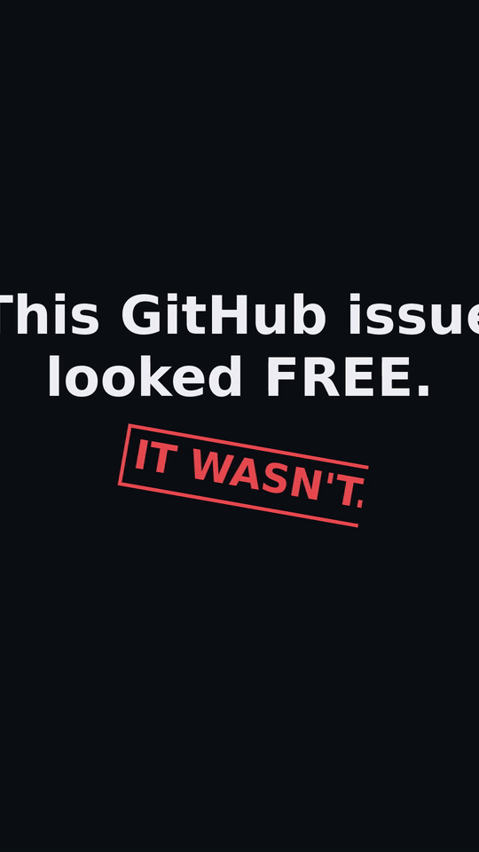

# Greenlight

Greenlight checks a GitHub issue before you spend hours on it, and tells you in plain words whether your pull request is likely to land.

**New:** [The Contribution Friction Index](https://cloudcorprecords.github.io/greenlight/) ranks 43 well known projects by how hard it really is to get a pull request merged, from live GitHub data.

## Watch it work



*The 59-second demo: real issue checks on real repos, an AI-caught hidden claim, a GATED agent ban, campaign scouting, and the claims babysitter. [Full narrated video](docs/assets/greenlight-demo.mp4).*

## Use Greenlight inside your AI coding tool

One command sets it up:

```bash
npx @reneturcios/greenlight init --agent claude-code
```

(also `cursor`, `copilot`, `windsurf`, `cline`; repeat `--agent` for more than one). Init copies the MCP config into your project and installs the workflow instruction snippet that teaches your agent the one behavior rule: **check Greenlight before it opens a PR.** Prefer doing it by hand? The [`integrations/`](integrations/README.md) drop-in pack has ready-to-copy MCP configs plus the same snippets. Then verify with a "list your MCP tools" prompt; the greenlight server carries 17 tools (check_issue, scan_repo, repo_friction, claim_issue, prep_issue, open_pr, ci_triage, review_triage, guard_pr, repo_digest, claim_status, preflight, verify_comment, babysit_prs, evidence_pack, scout_campaign, my_claims).

## The problem

You find an issue that looks perfect. You code all evening. Then one of these happens:

* Someone already claimed the work in a comment. The issue still says "unassigned", but three volunteers wrote "I'll take this" weeks ago and you never saw it.
* The repo wanted you to ask first. Your pull request gets closed because the maintainers require contributors to request assignment or get a vouch (a recommendation from someone they know) before anyone may open a PR, and nobody told you.
* Your commits get rejected on a technicality. The repo requires a "Signed-off-by" line on every commit (called DCO sign-off, short for Developer Certificate of Origin) or an entry in its changelog folder, and you find out after you push.

These are all contribution rituals: unwritten rules a repo expects before an outside pull request counts. Every repo has different ones, and they hide in different places, from CONTRIBUTING files to AGENTS.md house-rules files (plain-language instruction files that tell people and coding agents how to work in that repo). We hit all of these by hand while vetting real issues, so Greenlight automates the checking.

## What Greenlight does

One engine, four plain steps:

1. **Check before you claim.** Point it at any issue URL. It reads the issue, its comments, linked and mentioned pull requests, and the repo's rules, then answers: GO (yours to take), RISKY (possible, but know this first), TAKEN (someone is on it), GATED (a repo rule blocks you), or STALE (abandoned). It also spots partially-claimed work and issues where half the fix already shipped, so you scope to what remains.
2. **Claim the right way.** It drafts the claim comment in the form the repo's rules actually want: a plain "I'll work on this" where that is enough, an assignment request where the repo requires one, or a refusal where a vouch is needed (no tool can vouch for you). It never posts without your say-so.
3. **Prep your workspace with the repo's own rules.** It sets up your fork and branch, then writes a checklist that includes what it learned from the repo itself: the house-rules files, the verify command they insist on, whether the repo wants a changelog entry, and how its commits are styled.
4. **Open the PR only when the basics pass.** It checks the branch is really ahead of the repo, and on repos that require DCO sign-off it verifies every commit carries the Signed-off-by line before it opens the pull request.

## Use it when

* You found an issue you like and are about to spend real time on it.
* You want to know if an issue is really still yours to finish, or whether someone quietly claimed part of it in a comment.
* A repo's rules are unclear and you want to see them summarized before you start.
* You claimed something a while ago and want to know if that claim still counts.
* You are picking between several repos or issues and want the most winnable one first.

## What it does, technically

One engine, four surfaces:

1. **Availability verdicts** for an issue: `GO`, `RISKY`, `TAKEN`, `GATED`, `STALE`. Signals: assignees, linked open/closed/merged PRs (timeline + search + comment references), claim-comment heuristics including scoped claims and bare short claims (phrases like "please assign", "working on this", "taking the remaining fallback ask", "I'll take this"), partially-addressed detection (merged PRs that reference the issue, maintainer comments like "half addressed ... leaving this open"), issue age and last activity.
2. **Repo friction scores** (0-100, 100 = easiest): contribution gates parsed from CONTRIBUTING variants plus house-rules files (`AGENTS.md`, `CLAUDE.md`), with each gate recording which file its evidence came from (assignment-first, vouch, CLA, DCO, discussion-first, comment-first, collaborators-only, paused unsolicited PRs, external PRs auto-closed by workflow), plus outcome signals where computable.
3. **Scan mode**: rank a repo's open good-first-issue / help-wanted issues by verdict so a contributor (or agent) picks a winnable one first. Falls back to recent open unassigned issues when a repo has no labeled starter issues.
4. **Contribution automation**: `claim`, `prep`, and `pr` commands (plus matching MCP tools) that run the pipeline after the verdict. All writes are dry-run by default and need a token plus an explicit go flag.

A validation corpus of thirteen real cases from the campaign (`test/fixtures/cases/`, run by `test/cases.test.ts`) pins every verdict rule to something that actually happened: a taken issue, a weak PR mention, claim-first gates, assignment and vouch gates, a scoped claim, a half-shipped issue, a clean GO, a stale claim, fix-announcement PR links in sibling repos, a duplicate of a completed issue, and paused unsolicited PRs with a close-external-PRs workflow.

## Install

```bash
npx @reneturcios/greenlight check <issue-url>
```

Set up your AI coding tool and verify the setup:

```bash
npx @reneturcios/greenlight init --agent claude-code   # one-command MCP setup (cursor, copilot, windsurf, cline work too)
npx @reneturcios/greenlight doctor                     # checks Node version, token, GitHub quota, cache
```

Or from source:

```bash
npm install
npm run build
```

Set `GITHUB_TOKEN` (a classic personal access token, no scopes needed for public repos) to raise the GitHub API rate limit from 60 to 5000 requests per hour. Greenlight caches API responses under `~/.cache/greenlight`.

Run the MCP server with `npx @reneturcios/greenlight mcp` (stdio), or point your agent at the `greenlight` command with the single argument `mcp`.

## The toolkit

Greenlight is the front door of a four-tool lifecycle for open-source contribution work, all published under the same npm scope and cross-wired:

1. **gatefile** (`npx @reneturcios/gatefile extract owner/repo`) extracts a repo's contribution gates into a committed `contribution-gates.json`. Greenlight consumes that file directly: `greenlight check <issue-url> --gates-file contribution-gates.json`, or automatically when the file sits in the working directory, so gates are answered once and reused instead of re-derived from prose.
2. **greenlight** verdicts, scans, claims, prep, and PR opening (this tool).
3. **claimcheck** (`npx @reneturcios/claimcheck claims owner/repo`) watches claimed issues for stale claims and finished fixes parked on forks, the two ways claimed work silently dies.
4. **prwatch** (`npx @reneturcios/prwatch attention --user you`) triages your open PRs by what needs you right now: review threads, failing checks, conflicts, reviewer silence.

Each tool is a CLI and an MCP server (`<tool> mcp`).

## CLI

```bash
# One-command setup for your AI coding tool (cursor, copilot, windsurf, cline work too)
npx @reneturcios/greenlight init --agent claude-code

# Verify the setup: Node version, token, GitHub quota, cache (exit 1 when anything fails)
npx @reneturcios/greenlight doctor

# Help: overview, one command's flags, or the version
npx @reneturcios/greenlight help check
npx @reneturcios/greenlight --version

# Verdict for one issue
npx @reneturcios/greenlight check https://github.com/batrapulkit/squidbrake/issues/74

# [GO] batrapulkit/squidbrake#74
#   Taint: tell the approver when an agent edits its own setup right after reading outside content
#   - open, unassigned, no linked PRs, no claim signals, no blocking gates

# Rank a repo's starter issues, GO first (falls back to recent open
# unassigned issues when the repo does not use those labels; --no-fallback to opt out)
npx @reneturcios/greenlight scan PrefectHQ/fastmcp

# Friction score for a repo
npx @reneturcios/greenlight friction triggerdotdev/trigger.dev

# CI triage for a red PR: is each failing check yours or pre-existing?
npx @reneturcios/greenlight ci https://github.com/reticlehq/reticle/pull/1620

# [pre-existing] install-gate (windows-latest)
#   same check failing on base: 2 of 3 recent base runs, last at 2026-10-14T10:00:00Z

# [external-blocker] Vercel - Authorization required
#   check name matches the Vercel deploy/auth pattern; this failure is infrastructure, not the PR

# JSON output for scripting
npx @reneturcios/greenlight ci <pr-url> --json

# Review triage for a PR with review feedback: which comments need you?
npx @reneturcios/greenlight review https://github.com/n8n-io/n8n/pull/41235

# Campaign scout: rank repo targets, dedupe against the campaign file, append as SCOUTED
npx @reneturcios/greenlight scout --repos acme/widgets,acme/gadgets --campaign campaign.json --write

# Babysit your registered claims: linked, healthy-active, heartbeat-due, expiring, unlinked-stale, queue-lost
npx @reneturcios/greenlight babysit --claims-only

# [likely-real] interpolation drops `__proto__` (packages/bruno-cli/src/runner/interpolate-vars.js:42)
#   why: anchor matches: the comment's quoted token Object.assign({}, params) is present in the anchored hunk
#   draft reply: Good catch. Fixed in <next commit>: ...

# Maintainer guard for an incoming PR: competing fix, prior claims, missing
# artifacts (changeset / DCO / CLA), first-time contributor. Renders markdown
# ready to post as one comment; Greenlight itself never posts.
npx @reneturcios/greenlight guard https://github.com/owner/repo/pull/123

# Greenlight guard: 1 thing to check
#   - Missing release-note file (repo uses .changes/): expected .changes/123-slug.md
npx @reneturcios/greenlight guard <pr-url> --quiet   # exit 3 when flagged, silent otherwise

# Verified comment for a maintainer-only repo: the issue takes no outside
# PRs (inspector, servers), so the contribution is a detailed, verified
# comment. Assembles from your notes or a markdown file; sections you
# leave empty render as explicit gaps, never filler. Never posts.
npx @reneturcios/greenlight verify-comment https://github.com/modelcontextprotocol/inspector/issues/2723 \
  --claim "TUI tests append to the developer's real ~/.mcp-inspector/auth.log" \
  --env "modelcontextprotocol/inspector @ 3a4b5c6, 2026-10-15" \
  --repro $'point HOME at a scratch dir\nrun: vitest run __tests__/App.test.tsx' \
  --observed "155 lines appear in the scratch HOME's auth.log" \
  --expected "test runs leave the developer's home directory untouched" \
  --root-cause "clients/tui/__tests__/setup.ts does not isolate the log dir" \
  --fix "per-test-file temp dir via fs.mkdtempSync, set MCP_INSPECTOR_LOG_DIR, remove on exit" \
  --ran "vitest run __tests__/App.test.tsx: 130 passed" \
  --by "@CloudCorpRecords"
# or: greenlight verify-comment <issue-url> --from-file notes.md

# Honest red-green test delta, in your repo checkout: runs the detected
# test command on a base worktree and your working tree, and reports what
# your change actually did: newly passing (fixed), newly failing (yours),
# still failing (pre-existing, not yours). Says "unverifiable" with the
# reason instead of guessing when it cannot run or parse.
cd your-repo && npx @reneturcios/greenlight verify --base origin/main
# exit 3 when new failures exist, 1 when unverifiable

# PR babysitter: one prioritized action list across your open PRs —
# needs you now, waiting on them, quiet. Reruns report what changed.
npx @reneturcios/greenlight babysit --mine --repos acme/widgets,acme/gadgets
# or: greenlight babysit --prs <url1>,<url2> --fail-on-action   (exit 3 when action is needed)

# Verified PR evidence pack: guard + CI triage + review triage + protocol
# status of linked issues, in one markdown document where every claim
# cites its source. The test delta comes from a verify report you pass in.
npx @reneturcios/greenlight evidence https://github.com/acme/widgets/pull/42 --out EVIDENCE.md
# or: greenlight evidence <pr-url> --verify-json verify.json

# Contributor passport: protocol claims from the public Claim Ledger plus
# merged PRs from GitHub. No Ledger file yet? It says so plainly.
npx @reneturcios/greenlight passport CloudCorpRecords
```

Real examples from our vetting:

* `batrapulkit/squidbrake#74` scores **GO**: 0 comments, labeled help wanted, no claims, no gates.
* `shadcn-labs/pdfcn#58` scores **RISKY** (claimed flag): a volunteer asked for assignment the same day we vetted it.
* `langchain-ai/langchain#41185` scores **TAKEN** (claim race): 3 strong claimants while still "unassigned".
* `PrefectHQ/fastmcp#5718` scores **GATED**: FastMCP requires assignment or a "prs welcome" label before a PR.
* `triggerdotdev/trigger.dev#5016` scores **GATED**: unvouched-author PRs are auto-closed, a vouch request goes first.

## How scoring works

The verdict engine is deterministic (no LLM) and checks, in order:

1. Closed issue: **TAKEN** (never landable).
2. Any assignee: **TAKEN**.
3. An open linked PR that **closes** the issue: **TAKEN**. A PR that merely mentions the issue number (like pdfcn PR #91, which closes #70 but lists sibling issues in its body) only adds a `weak-pr-mention` flag and downgrades an otherwise-GO verdict to **RISKY**. Marked a duplicate of an issue closed as completed: **RISKY** with the `duplicate-of-closed` flag (the work already shipped; a still-open duplicate target only adds a `duplicate-of-open` warning with its URL).
4. Two or more strong claimants: **TAKEN** (claim race).
5. One strong fresh whole-issue claim (under 45 days): **RISKY** with the `claimed` flag. A fresh claim scoped to part of the issue ("taking the remaining fallback ask"): **RISKY** with `claimed` + `partial-claim` flags and a reason naming the claimer and the scope, never TAKEN.
6. One strong claim older than 45 days with no closing PR: **RISKY** with the `stale_claim` flag. The claimant probably walked away, but nobody knows for sure. Stale scoped claims get the same treatment.
7. A hard gate (assignment, vouch, collaborators-only, paused unsolicited PRs, external PRs auto-closed by workflow) with nobody assigned: **GATED**. The last two come from CONTRIBUTING language (\"paused unsolicited pull requests\") and a scan of `.github/workflows` for close-external-PR automation.
8. No activity for 180+ days: **STALE**.
9. A soft claim-first gate (the repo asks contributors to comment before starting, like pdfcn): never **GATED**; it caps an otherwise-GO verdict at **RISKY** with a note, the same downgrade shape as a weak PR mention.
10. Otherwise: **GO**.
11. An open PR referenced in a non-author comment whose title/body mentions the issue number: downgrades an otherwise-GO verdict to **RISKY** with the `comment-mentioned-pr` flag ("may already cover part of this issue"). Neither can produce **TAKEN**; only closing PRs do that. Fix-announcement comments ("/attempt #N" commands or "Submitted fix for ... in <PR url>" narratives, often linking PRs in sibling repos) get the same downgrade under their own reason quoting the PR URL, with the `attempt-linked-pr` flag, even when the PR never names the issue. `/attempt` comments also register as strong claims.
12. **Partially-addressed**: merged PRs that reference the issue number (comment-mentioned or linked), or maintainer comments signaling part of the work already shipped ("Half addressed by #905, leaving this open for half B", "Shipped in v3.1.0" next to the issue reference). A plain **GO** hides the scoping work this needs, so the flag `partially-addressed` is added, an otherwise-GO verdict is capped at **RISKY** with a reason like "part of this issue already shipped (PR #905, merged); scope your work to what remains". Never **TAKEN**.

Claim detection scans comments for explicit claim phrases, in-progress signals ("fix ready", "PR incoming", "opened a PR"), and soft offers ("happy to fix", "take a look at this one"). Bot authors are ignored, as are issue reporters unless they announce a ready fix. Soft claims now carry their comment date, so the verdict can show how old they are (the `weak-claim` flag, warning only). Scoped claims ("taking the remaining fallback ask", "claiming this half") are recorded as partial: a fresh partial claim downgrades an otherwise-GO verdict to RISKY with a reason naming the claimer and the scope, never TAKEN. PR references (#NNN) in non-author comments are cross-checked against the PR API: an open referenced PR that mentions the issue downgrades GO to RISKY with the `comment-mentioned-pr` flag, and a merged one feeds rule 12 above.

### Optional AI claim detection

The pattern layer cannot know every way a human says "I'm taking this" (one evening it missed "I'm looking into contributing a fix here" on a real issue). Set `FIREWORKS_API_KEY` and `check` gains an optional second pair of eyes: a cheap Fireworks model reads the eligible comments (bots and the issue author excluded, same pool as the patterns) and flags statements of intent the patterns missed.

The governance is plain:

- **Off by default.** No key, no calls, output byte-identical to the pattern-only engine.
- **Patterns stay primary and cheaper.** The AI only runs when they found no strong claim.
- **Flags, never verdicts.** An AI flag adds the `llm-claim` flag with the exact quote as evidence and downgrades an otherwise-GO verdict to **RISKY**. It can never produce **TAKEN** and never overrides **GATED**. Verdicts stay deterministic.
- **No invented evidence.** The quote must be an exact substring of the comment body; anything else is dropped before it can reach the verdict.
- **Failures are silent.** A timeout, a non-200 response, or an unparseable reply returns no signal, never an error into the check path. Classifications are cached by comment id and model id, so repeat checks cost nothing.

Cost on the default model (`accounts/fireworks/models/glm-5p3-flash`): one issue check costs well under a tenth of a cent. Override the model with `GREENLIGHT_LLM_MODEL` and the endpoint with `GREENLIGHT_LLM_BASE_URL`. `greenlight doctor` reports whether the layer is configured (the key is never printed).

### v0.3.4: never race blind

One evening, five of twelve claimed issues were already taken. The races were not in the comments: they were in the issue timelines, where GitHub records PRs that reference the issue even when their bodies never say "closes #N". So `check` now reads the timeline. An open cross-referenced PR caps the verdict at **TAKEN** with the PR URL and title quoted. A merged one adds a "the issue may already be fixed, verify what shipped" note instead, capped at **RISKY**, because a merged PR can fix only part of an issue. Also new: emoji-proof fix-announcement matching ("Opened #NNN", "🤖 ..." prefixes), bounty-liveness warnings (dead platforms like Algora are named, unverified bounties are flagged, and bounties never raise a verdict), and a `possibly-server-side` warning when the issue's quoted error text does not exist anywhere in the repo. The `friction` command gains one more line when computable: the share of recent merged PRs written by outsiders and the median time to merge, straight from the API.

Friction score starts at 100 and subtracts gate weights (assignment -25, vouch -35, collaborators-only -50, paused unsolicited PRs -40, external PRs auto-closed -50, discussion-first -10, claim-first -5, CLA/DCO -5 each), adjusts for external PR merge rate and review/response times when computable, and adds up to +10 for open good-first-issues. Unknown signals stay null and are skipped, never guessed. See `src/friction.ts` for the exact formula.

## MCP server

The same engine is exposed over stdio for coding agents (Claude, Cursor, Cline). The wedge: agents waste the most tokens fixing already-taken issues. Have the agent pre-flight the issue before writing code.

```json
{
  "mcpServers": {
    "greenlight": {
      "command": "npx",
      "args": ["-y", "@reneturcios/greenlight", "mcp"],
      "env": { "GITHUB_TOKEN": "your-token" }
    }
  }
}
```

Tools:

* `check_issue` - verdict for one issue URL
* `scan_repo` - rank a repo's open issues, GO first (label-tagged starter issues, falling back to recent open unassigned issues)
* `repo_friction` - friction score for a repo
* `claim_issue` - verdict-gated claim comment (dry run unless `execute: true`)
* `prep_issue` - fork and branch check plus a local PREP.md checklist with the repo's learned conventions (dry run unless `execute: true`)
* `open_pr` - DCO-aware PR opening from a fork branch (dry run unless `execute: true`)
* `ci_triage` - classify each failing check on a PR as pre-existing, likely-yours, indeterminate (with a stated lean), or external-blocker, by comparing against the base branch's recent check history
* `review_triage` - triage the review feedback on your PR: each finding classified likely-real / likely-noise / needs-decision with its reason and a reply draft (humans are never called noise; drafts only, nothing posted)
* `guard_pr` - maintainer-side analysis of an incoming PR: competing fix, prior claims by someone other than the author, missing artifacts (changeset / DCO / CLA), first-time contributor. Returns comment-ready markdown (never posts).
* `repo_digest` - repo-level maintainer report: PR races with first-claim arbitration, claimed-by-other conflicts, stale claims, assignment-gate conflicts, triage-held issues (never posts).
* `claim_status` - Claim Protocol pre-flight for one issue: who holds it, until when, who is queued, competing PRs, gates, whether the repo honors the protocol
* `preflight` - the one-call answer: claim_status plus the repo friction summary
* `verify_comment` - draft the verified-finding comment for maintainer-only repos (draft only, never posts)
* `babysit_prs` - watch open PRs and get the one prioritized action list (needs you now, waiting on them, quiet), diffed against stored watermarks; also watches the my-claims registry (linked, healthy-active, heartbeat-due, expiring, unlinked-stale, queue-lost)
* `evidence_pack` - the Verified PR evidence pack for one PR: guard verdict, CI triage, review triage, protocol status of linked issues, every claim citing its source

Run it locally: `npm run dev` (MCP entry is `src/index.ts`; CLI is `src/cli.ts`).

### v0.9.0: compliance + campaign

Field work in October surfaced two repos publishing agent rules outside CONTRIBUTING (nuxt/nuxt's AGENTS.md bans autonomous-agent contributions outright; actualbudget/actual's AI policy requires an `[AI]` prefix plus a disclosure sentence), a fleet of mastra issues all carrying bot triage notices that scored GO with no gate kind for the hold, and two explicit soft claims the scan path missed because it ran the deterministic verdict alone. v0.9.0 closes all three gaps, then turns the campaign workflow into one command.

**Agent-policy gates.** Gate loading already reads AGENTS.md and CLAUDE.md as house-rule sources; two new gate kinds now parse them. `agents_banned` is a hard gate: a repo that bans autonomous-agent contributions scores GATED, with the quoted policy line as evidence, and `claim` refuses it like TAKEN unless `--force` (a human must still open the PR). `agents_disclosure` is a flag, never a verdict change: repos that require an `[AI]` prefix and an AI disclosure get concrete required actions from `prep` and `check`. Repos with neither policy produce byte-identical output to before.

**Triage hold.** A bot triage notice ("wait until maintainers remove the triage or approval label before opening a pull request") or a triage label (`needs triage`, `pending triage`, ...) marks an issue as held: `check` names the hold and caps an otherwise-GO verdict at RISKY with flag `triage-hold` (never TAKEN), scan demotes held issues below clean ones, and `digest` lists held issues per repo in their own section, the watch list for claims that may clear tomorrow.

**Claim AI on the default path.** `scan` now runs the same per-issue pipeline as `check`: legacy verdict, the optional Fireworks claim-intent layer when `FIREWORKS_API_KEY` is set, merged with the Claim Protocol. The 30-day classification cache (comment id + model) is shared across check, scan, and claim, and the layer's governance holds everywhere: flags only downgrade GO to RISKY via the `llm-claim` flag, never TAKEN, never overriding GATED; every flag carries an exact-substring quote; a failed classification round caches nothing.

**Claims babysitting.** When `claim` actually posts, the claim (issue URL, repo, number, posted_at, eta-days) is recorded into `~/.greenlight/my-claims.json`; `greenlight claim --register <issue-url>` records claims posted by other means. `babysit` gains a claims section (and `--claims-only`): each registered claim is bucketed by its live protocol status into linked (PR open, fine), healthy-active, heartbeat-due (no activity and the lease past half), expiring (lease under 48h), unlinked-stale (no PR after 72h), or queue-lost (someone ahead completed or the claim was superseded). Claims that complete retire from the registry with a note.

**Campaign scout mode.** `greenlight scout --repos o/r,... --campaign campaign.json --write` turns a repo list into ranked campaign targets: the scan pipeline per repo, issues already in the campaign file dropped in ANY status, survivors ranked by `30*verdictWeight (GO=2, RISKY=1) + 0.25*friction + 20*outsideMergeShare + 15/(1+medianMergeDays/14) + 5*freshness`, appended as `SCOUTED` with verdict and evidence summary. `--budget N` caps GitHub API calls (default 300); on budget hit the campaign file keeps a resume cursor and the scout exits cleanly, and a rerun resumes where it stopped. `--repos-file` takes one owner/repo per line.

```bash
greenlight scout --repos acme/widgets,acme/gadgets --campaign campaign.json --write
greenlight babysit --claims-only
```

### v0.9.1: the trust patch

A full day of dogfooding at portfolio scale (43 open PRs) found five fidelity problems, all fixed here. No new features, no new surface area beyond the repair.

**Babysit speed and honest failures.** Per-PR fetching is now parallel with a bounded concurrency (default 5, `--concurrency N` to override): a 15-PR sweep drops from ~9 minutes toward ~2. Each PR's reads get 2 attempts with a short backoff; a PR that still cannot be observed lands in a new `Could not check (transient)` section with its error kind (`transient` vs `usage`), never in needs-you or waiting, and its watermark is untouched so the next run reports it as if this run never happened.

**Guard flag subjects.** Every guard flag now carries a `subject`: `pr` (this PR's own diff, e.g. missing artifacts), `issue` (one of the PR's linked issues, e.g. a competing fix, with a canonical `owner/repo#N` `issueRef`), or `repo` (repo-wide signal). Babysit raises needs-you only for subject `pr`, and for subject `issue` when the issue is the PR's own linked issue; everything else collects into a `Repo notes` section, informational only. Field case: a babysit run on actual #9250 once reported "17 new things: Competing fix for #123" that belonged to other PRs in the repo; that shape now produces zero needs-you items from guard.

**Claim registry import.** `greenlight claim --import --ledger-user <github-login>` fetches the public Claim Ledger and imports every active or linked claim by that user into `~/.greenlight/my-claims.json`; `greenlight claim --import --urls <issue-url,...>` backfills manually. Re-imports dedupe; retired states are skipped.

**The proxy, shipped.** `greenlight proxy` starts the localhost forwarder that lifts you from the 60/hr anonymous quota to the 5000/hr authenticated budget: it reads `GITHUB_TOKEN` (or `GH_TOKEN`) once at startup, attaches it server-side, ignores incoming Authorization headers, binds 127.0.0.1 only, and refuses to start without a token. `greenlight doctor` now names the proxy as the remedy when you are unauthenticated.

**MCP parity.** Two new tools bring the server to 17: `scout_campaign` (campaign mode over MCP) and `my_claims` (the claims-bucketing half of the babysitter).

```bash
export GITHUB_TOKEN=<your-classic-token> && greenlight proxy &
export GREENLIGHT_GITHUB_BASE_URL=http://127.0.0.1:8792 GITHUB_TOKEN=proxy
greenlight claim --import --ledger-user <your-login>
greenlight babysit --concurrency 5
```

### v0.6.0: the babysitter, the autopilot, and the trust layer

**PR Babysitter.** `greenlight babysit` (or the `babysit_prs` MCP tool) is the answer to 34 open PRs and no time to watch them. Point it at PR URLs, or let it discover your open PRs across repos (`--mine --repos`), and it runs CI triage, review triage, and the guard on each one, diffs against stored watermarks, and prints one prioritized list: *needs you now* first (new likely-real review findings, CI newly failing on your code, merge conflicts, new guard flags, checks stuck over 2 hours), then *waiting on them* (checks still running, CI green with no feedback yet), then *quiet* (a PR that merged or closed retires from the watch with its resolution noted). The first run has no watermarks, so it says so and shows the full picture. Exit 0 always (cron-friendly); `--fail-on-action` gives exit 3 when the needs-you-now list is non-empty.

**Maintainer Autopilot.** The guard Action can now act, not just report — but only when the maintainer opts in. An `autopilot` section in `.greenlight-guard.json` carries a label map (check id to label name, e.g. `"protocol-claim": "claim-conflict"`) and a nudge toggle. The guard computes label decisions over severity-flag findings and ready-to-copy stale-claim nudge lines for 14+ day claims with no other open PR; it never applies anything itself. The Action applies the decided labels with the Actions token (creating labels that do not exist yet; failures degrade to warnings, never a failed run), and the nudge lines ride inside the single guard comment for the maintainer to post on the issue. Autopilot never closes PRs, never merges, and never posts beyond the one guard comment. `greenlight guard <pr-url> --labels-dry-run` shows exactly what it would do.

**Evidence pack and passport.** `greenlight evidence <pr-url>` (or the `evidence_pack` MCP tool) assembles the Verified PR evidence pack: guard verdict, CI triage, review triage, and Claim Protocol status of the linked issues, in one markdown document where every claim cites its source — the check run, the review anchor, the claim comment URL. The test-suite delta is included only when you hand it a `greenlight verify --json` report; the pack never runs suites itself and says so when the report is missing. And `greenlight passport <github-login>` renders the contributor passport: protocol claims from the public Claim Ledger (active, queued, the completed-vs-expired honor record, the over-cap flag) plus merged PRs from GitHub — the trust layer the Claim Protocol was always heading toward.

### v0.3.5: CI triage (solve-first)

The first solve-side command. On a red PR, `ci` fetches the PR's base and head, collects the failing check runs (with the first failure lines from annotations when it can), and builds the same checks' history from the twelve most recent base-branch commits. Each failing check gets one line with its class and the evidence: `pre-existing` (same check failing on base, with counts and the last failure time), `likely-yours` (failing on head, passing on base, and the PR touches files that relate to the check), `indeterminate` (no base signal to compare), or `external-blocker` (Vercel/Netlify/deploy-preview auth failures, infrastructure not the PR). Indeterminate checks always state their lean: not touching the check's area leans pre-existing, touching it leans yours, with the reason spelled out. A verdict line closes it out: ALL PRE-EXISTING, HAS LIKELY-YOURS, INDETERMINATE, or NO FAILURES.

### v0.3.7: prep hardening (solve-first)

The third solve-side upgrade, to `greenlight prep`. The checklist now starts with the exact signing path the repo demands (CLA Assistant with its signature phrase, a repo-specific CLA bot's signing page, or DCO with `git commit -s`) and the release-note artifact it owes (`.changeset/`, `.changes/<issue>-slug.md`, towncrier fragments, or a CHANGELOG note). Before anything else, it runs the fix-lives-here check: the v0.3.4 server-side signal plus a satellite-repo hint that fires only on tight textual evidence, warning prominently when the fix may not be buildable from this repo. A house-rules block closes it out: claim style, PR title convention, draft-first norm, and the test command, each with its source file.

### v0.3.9: the maintainer guard

Guard flips the engine around: `greenlight guard <pr-url>` (or the `guard_pr` MCP tool) analyzes an *incoming* pull request and renders one short markdown report a maintainer can post as a comment. It checks for a competing fix (other open PRs already fixing the same issue, found via the issue's timeline), prior claims by someone other than the PR author, missing required artifacts (a `.changes/` or `.changeset/` file the repo assembles its changelog from, DCO sign-off trailers, CLA status), and whether the author is a first-time contributor. Output starts with a one-line summary ("Greenlight guard: nothing flagged" or "N things to check"), `--quiet` stays silent unless flagged, and exit code 3 tells a workflow when findings exist. The repo ships a composite GitHub Action (`action.yml`) that posts or updates a single comment on each PR, an `examples/guard-workflow.yml` a maintainer copies into `.github/workflows/`, and per-repo check toggles through `.greenlight-guard.json`.

### v0.4.0: the Claim Protocol

GitHub has no claim system, only comments — so Greenlight now ships one. A claim is a comment carrying the `<!-- greenlight-claim v1 -->` marker (full spec: [`protocol/SPEC.md`](protocol/SPEC.md)): an expiring lease (7-day default, renewable by heartbeat — any comment, or a rocket reaction on the claim comment) with a public queue, frozen the moment a PR links and ended by expiry, release, or a merged PR. Repos can opt in with `.greenlight/claims.json` on their default branch; repos that haven't are read claim-by-claim with no policy assumed.

```bash
# Who holds this issue, until when, who is queued, which PRs compete
greenlight status https://github.com/ComposioHQ/composio/issues/4668

# The claim comment greenlight claim drafts now carries the marker,
# optional plan/eta lines, and the protocol footer (--plan, --eta-days)
greenlight claim <issue-url> --plan "reproduce then fix" --eta-days 5
```

Precedence, so the two engines never fight: a live protocol claim (active, linked, completed) wins over the legacy *claim inference* in `check` — its reason replaces the old claim-derived lines and the flag becomes `protocol-claim`. It never overrides gates, and never overrides cross-referenced PR evidence (when both say TAKEN, the reasons merge). Old-fashioned claims with no marker still run the legacy engine unchanged, and the guard raises a `protocol-claim` flag when a PR's linked issue is held by someone other than the PR author.

Two new MCP tools make 12: `claim_status` (the full SPEC 5.1 status payload) and `preflight` (claim status plus the repo friction summary, the one-call "can I work on this" answer). Over-cap squatting detection ships library-only in this release: the engine's `applyOverCap` needs a global per-account index that Phase 1 does not build, so it is exported but uncalled, going live with the Phase 2 Ledger.

### v0.3.11: the repo digest (maintainer-side)

Guard answers "what is wrong with this PR"; digest answers "what needs my attention across my whole repo". `greenlight digest <owner/repo>` (or the `repo_digest` MCP tool) prints one markdown report in four sections: **PR races** (two or more open PRs fixing the same issue, same-repo and cross-repo links included, with first-claim arbitration: who claimed first, who opened first, who duplicates effort), **claimed-by-other conflicts** (an open PR whose linked issue was claimed by someone else before the PR), **stale claims** (issues claimed 14+ days ago with no open PR, with "nudge" under 30 days and "release the claim" after), and **assignment-gate conflicts** (repos that require assignment before a PR: open PRs whose author is not among the issue's assignees). The summary header always states the list cap and the true open-PR total (`--limit N` bounds the API budget; comment reads are skipped for comment-less issues, timeline walks happen only for stale-claim candidates). `--json` for machines; `--fail-on-race` exits 3 when a race exists so a nightly job can alert. A section that cannot be computed says so and why, never silently empty.

The digest is Greenlight's first step from pre-flight into the maintainer's weekly triage: guard catches a bad PR at the door, digest tells you which issues and PRs across the repo are quietly rotting.

### v0.3.6: review triage (solve-first)

The second solve-side command. On a PR with review feedback, `review` gathers every review thread (bot and human), classifies each finding, and drafts the reply for you. Findings group into three buckets: **likely-real** (the comment's quoted anchor token is in the diff hunk; fix these), **needs-decision** (bot questions and every substantive human comment, which is never called noise; your call), and **likely-noise** (findings on generated files, style nits contradicted by the surrounding code, anchor mismatches, security claims the hunk disproves; probably push back). Each finding prints with its author, file and line, the one-line summary, the deterministic reason for its class, and the draft reply. Summaries, walkthroughs, praise, and findings on dismissed reviews count as noise or resolved, never as findings. Like everything in Greenlight, the drafts are output only: nothing is posted.

## Automation

Greenlight 0.2.0 automates the contribution pipeline its author ran by hand
for four real PRs (shadcn-labs/pdfcn #92-#95): verdict, claim comment, fork
branch, and opening the PR, with DCO awareness throughout.

```bash
# 1. Claim the issue: verdict first, comment shaped by the repo's gates
greenlight claim https://github.com/shadcn-labs/pdfcn/issues/65

# 2. Prepare: fork/branch check (learning the repo's branch convention) plus a PREP.md checklist
greenlight prep https://github.com/shadcn-labs/pdfcn/issues/65 --dir /tmp/prep65

# 3. Open the PR from your fork branch (verifies DCO sign-off on DCO repos)
greenlight pr https://github.com/shadcn-labs/pdfcn/issues/65 --branch feat/quarterly-report-block
```

Safety defaults, and this is a feature:

* **Dry run by default.** All three commands print exactly what they would
  post or create and exit. Nothing is posted or created without `--yes`
  (CLI) or `execute: true` (MCP).
* **Writes need a token.** Read ops work with no token at all. Write ops
  require `GITHUB_TOKEN` (or `GH_TOKEN`); without one they print a clear
  error naming the env var and exit non-zero.
* **Verdict-gated.** `claim` refuses TAKEN or STALE verdicts unless
  `--force`, and refuses vouch-gated repos outright (a vouch cannot be
  automated). Assignment-gated repos get an assignment request instead of
  an intent comment; claim-first repos (comment before starting) get the
  standard intent comment, which satisfies the ritual.
* **Repo-aware branch names.** `prep` reads the head branches of recent
  closed PRs and follows a dominant convention (pdfcn's `feat/<slug>-block`)
  while still showing the `feat/<slug>-<number>` default.
* **DCO-aware.** On DCO repos, `pr` verifies every commit on the branch
  carries a `Signed-off-by:` line and refuses, listing the unsigned
  commits, when one is missing.
* **Repo-aware prep.** `prep` also learns the repo's contribution rituals
  for the PREP.md checklist: which house-rules files exist, the verify
  command they insist on (like `pnpm verify`), whether the repo assembles
  its changelog from a `.changes/` directory, which root package.json
  scripts exist, and whether recent commits follow Conventional Commits.
  Binding rules increasingly live in `AGENTS.md` rather than CONTRIBUTING,
  and prep reads those too.

## The friction index

`data/friction-index.json` is a checked-in, growing dataset of scored repos. It starts with the MCP/AI ecosystem we hand-vetted on 2026-10-13 (FastMCP, trigger.dev, langchain, deepagents, openclaw, squidbrake, reticle, pdfcn, chatflow-agent, and the three MCP SDK repos). Regenerate it with `npm run index`.

Entries labeled `hand-verified 2026-10-13` come from reading the repos' actual policies and issue trackers by hand. Entries labeled `live` were parsed from live house-rules files (CONTRIBUTING variants, AGENTS.md, CLAUDE.md). Each gate records which file its evidence came from. Computed outcome fields (merge rates, review times) stay `null` until we can compute them honestly, never fabricated.

## Development

```bash
npm test    # tsx --test, includes fixture tests that reproduce our real verdicts
npm run build
```

## Roadmap (Later)

* Review-response triage: gather every bot and human review thread on a PR, classify each finding (real, noise, needs a decision) with the code context, draft the reply or fix list (solve-first, next after CI triage)
* Claim-to-PR prep scaffolding: emit the per-repo work order (house rules, CLA method and link, changeset conventions, fork/branch names) from one `prep` pass
* Browser extension that scores issues inline on github.com
* Hosted dashboard of the friction index, refreshed on a schedule
* Maintainer GitHub Action that auto-labels claim comments
* Parked-fix detection and auto-nudges: scan forks for branches referencing open issues and nudge when the gate is satisfied

## License

MIT. See LICENSE.
